<div align="center">



<br>

### Software · Cybersecurity · Data · Automation · Digital

<br>


</div>

---

## What We Build

OxNeural is a technology team building software, security, data and automation systems — and documenting them to a standard that lets someone else operate, review or audit what we build.

| Area | What it covers |
|---|---|
| **Software & Application Development** | Backend systems, REST APIs, web applications and integration work on a Python-centred stack |
| **Cybersecurity & SOC** | Security monitoring, SIEM and EDR operations, detection engineering, alert triage, investigation and incident response |
| **Data & Automation** | ETL pipelines, data processing and analysis, workflow and API automation, and machine learning where it genuinely fits the problem |
| **Cloud Engineering** | AWS and Azure deployment, IAM and least-privilege design, cloud logging and operational automation |
| **Digital Services** | Content creation, video editing and digital marketing support — *an emerging capability, not an established department* |

<br>

**How to read status markers on this profile**

🟢 Active Development  ·  🔵 Documentation & Design  ·  🟡 Planned  ·  ⚪ Research / Exploration

---

## Technology Stack

Everything below is in-house capability with delivered work behind it, governed by [`technology-stack.md`](https://github.com/Oxneural/oxneural-handbook/blob/main/docs/development/technology-stack.md) in the handbook. **Anything not listed is not claimed.** Adding a technology requires a pull request naming the project where it was used.

<br>

<div align="center">

**Programming Languages**


**Backend & Application Development**


**Data Engineering & Analytics**


**Machine Learning**


**Databases**


**Cloud**


**Security & SOC Lab**


**Engineering & Collaboration**


</div>

---

## Automation & AI Engineering

Automation is a core engineering practice here, not a product line. Most of it is Python: moving data between systems, talking to APIs, shaping files, and removing the manual steps that quietly consume analyst and developer time.

**Capabilities** — confirmed, with delivered work behind them:

| Capability | Built with |
|---|---|
| **API automation & integration** | Python · REST APIs · JSON · Postman |
| **ETL & data pipelines** | Python · pandas · SQL · Snowflake |
| **Data processing automation** | Python · pandas · NumPy · CSV / JSON / file handling |
| **Workflow automation** | Python · scheduled jobs · API orchestration |
| **Reporting automation** | Python · pandas · Matplotlib · SQL |
| **Cloud operational automation** | AWS · Azure · Amazon S3 |
| **Security automation** | SIEM → SOAR workflows · alert enrichment · Wazuh · Shuffle |

<br>

**Typical Engineering Workflow**

```
        USER / EVENT / SCHEDULE
                  │
                  ▼
          AUTOMATION LAYER
        Python · API · Workflow
                  │
                  ▼
             PROCESSING
     validate · transform · enrich
                  │
                  ▼
      DATABASE · CLOUD · SECURITY
      SQL · S3 · IAM · SIEM / SOAR
                  │
                  ▼
       REPORT · ALERT · ACTION
```

This is the shape most of our automation work takes. It is a reference pattern, **not a single deployed platform** — individual projects implement the parts they need.

<br>

**AI Engineering** ⚪ *Research / Exploration*

Applied machine learning — classification, online learning with River, and analysis pipelines — is confirmed capability and appears under **Data, AI & Machine Learning** below. Beyond that, work on retrieval, agent orchestration and LLM integration is exploratory and internal. **It is not offered as a service and no delivered capability is claimed for it.** If it becomes real, it will appear here as a documented repository like everything else.

---

## Data, AI & Machine Learning

| Practice | Detail |
|---|---|
| **Data engineering** | ETL · data cleaning · data manipulation · processing and sorting |
| **Analysis** | Exploratory analysis · preprocessing · feature preparation |
| **Machine learning** | scikit-learn for batch models · River for online / streaming learning |
| **Visualisation & reporting** | Matplotlib · automated report generation |
| **Storage & querying** | PostgreSQL · MySQL · Oracle · SQL Server · Snowflake |

Machine learning is applied where it is the right tool. A rule, a query or a well-written script is often the better answer, and we will say so.

---

## Cybersecurity & SOC

The area the founder leads personally, and the deepest verified capability in the team.

| Discipline | Detail |
|---|---|
| **Monitoring & detection** | Security monitoring · SIEM and EDR operations and integration · threat detection · detection engineering |
| **Investigation** | Alert triage · log analysis · threat investigation · incident investigation |
| **Response** | Incident response · containment planning · documented playbooks |
| **Identity & cloud** | IAM · least-privilege design · cloud security · security hardening |
| **Assurance** | Vulnerability management · security assessments · security automation |

<br>

### 🛡️ AWS Cloud SOC Lab — technology flow

```
              AWS ACCOUNT
                  │
                  ▼
      CLOUDTRAIL · VPC FLOW LOGS
                  │
                  ▼
              AMAZON S3
                  │
                  ▼
           WAZUH  (SIEM)
        detection engineering
                  │
                  ▼
          SHUFFLE  (SOAR)
      threat-intel enrichment
                  │
                  ▼
          HUMAN APPROVAL
      required for any disruptive
             action
                  │
                  ▼
        RESPONSE · DOCUMENTATION
```

**🔵 Documentation & Design — no AWS resources are deployed.** The architecture, cost model, deployment and teardown plans, detection and incident-response documentation and acceptance criteria exist. The build phases do not. That status is stated in the repository and is not softened here.

**On 24/7 coverage:** scalable SOC capability subject to staffing, scope and SLA requirements. We do not operate a fully staffed round-the-clock SOC and do not claim to. <!-- claims-ok: stated only to bound it, not to claim it -->

**On security testing:** selective, scope-based testing subject to written authorisation, defined scope, capability, timeline and resources. It is not our primary security positioning, and no testing of any kind happens without written authorisation.

---

## Software Engineering

Backend development in Python with Django and FastAPI · REST API design, development and integration · JSON, CSV and file processing · web development with HTML, CSS and Bootstrap · relational database design across PostgreSQL, MySQL, Oracle, SQL Server and Snowflake · ETL and data processing · deployment on AWS and Azure · hosting and domain management.

**Delivery flow**

```
   REQUIREMENT      →   what problem, whose problem
        │
        ▼
   ARCHITECTURE     →   decisions recorded, with reasons
        │
        ▼
   DEVELOPMENT      →   reviewed pull requests only
        │
        ▼
   API · DATABASE   →   contracts and schema documented
        │
        ▼
   TESTING          →   results recorded, not assumed
        │
        ▼
   DOCUMENTATION    →   operable by someone who
        │                wasn't there
        ▼
   DEPLOYMENT       →   with a written rollback
```

A reference process, not a claim that every project runs every step. Small utilities are documented proportionately — the [README standard](https://github.com/Oxneural/oxneural-handbook/blob/main/docs/standards/readme-standard.md) has three tiers for exactly that reason.

---

## Featured Projects

### 🛡️ OxNeural Cloud SOC Lab

**Status** 🔵 Documentation & Design → 🟡 Implementation roadmap

An AWS-based security operations laboratory: log collection from AWS into a SIEM, detection engineering, automated enrichment, and incident response with human approval gates.

**Technology** — AWS · Wazuh · Shuffle SOAR · IAM · CloudTrail · VPC Flow Logs · Amazon S3 · SSM Session Manager · threat-intelligence enrichment

Three design choices worth noting:

- **Zero inbound rules on every security group.** Access is exclusively through AWS Systems Manager Session Manager; dashboards are reached by port forwarding to localhost. No SSH, no exposed admin interface.
- **Every disruptive response action requires human approval.** Automation gathers context and prepares the action — a person decides. The SOAR platform holds no standing AWS permissions.
- **Every claim carries an evidence label.** `[VERIFIED FACT]` statements cite official AWS, Wazuh or Shuffle documentation; `[DESIGN DECISION]`, `[ASSUMPTION]` and `[OPEN QUESTION]` mark everything else. Test results stay empty until tests are actually run.

**Documentation** — architecture · decision records · cost model · deployment, rollback and teardown plans · detection and IR documentation · acceptance criteria

[](https://github.com/Oxneural/oxneural-soc-lab)

<br>

### 📘 OxNeural Handbook

**Status** 🟢 Active Development

The team's engineering standards, in the open: repository and README standards, git and commit conventions, pull-request expectations, a security baseline, detection-engineering method, client-confidentiality rules, and templates for project READMEs, statements of work, requirements specifications, case studies and security reviews.

**Technology** — Markdown · Git · GitHub · documentation tooling

It is public deliberately. Collaborators and clients can see how we work before engaging us, and our own standards get the same scrutiny as our code. The confirmed technology list on this profile is governed by a file in this repository.

[](https://github.com/Oxneural/oxneural-handbook)

---

## Engineering Principles

| | |
|---|---|
| **Secure by design** | Least privilege, no standing credentials, no exposed admin interfaces |
| **Automation where it helps** | Automate the repetitive and the error-prone — not for its own sake |
| **Document what we build** | If someone else cannot operate it from the documentation, it is not finished |
| **Test before delivery** | A control that has never been tested is an assumption, not a control |
| **Evidence over assertion** | No metric without a stated measurement method |
| **Reproducible engineering** | Recorded decisions, version-controlled configuration, repeatable setup |
| **Least privilege** | Access granted per task, reviewed, and removed when the work ends |
| **Clear ownership** | Every repository has an owner, a classification and a status |
| **Honest labelling** | Personal, academic and previous work is never presented as company or client work |
| **Reviewable change** | Protected branches, pull requests, code review |
| **Reversibility** | Teardown and rollback written before build, not after |
| **Continuous improvement** | When we get something wrong, the correction stays in the repository |

---

## Team

**Leadership**

| Name | Role |
|---|---|
| [Muzaffar Moosa Shaikh](https://www.linkedin.com/in/cyber-shaikh/) | Founder · CEO · CTO |

**Software & Application Development**

| Name | Role |
|---|---|
| [Mashkoor Patel](https://www.linkedin.com/in/mashkoorpatel/) | Technical Lead — Development |
| [Huzefa Siddique Bagwan](https://www.linkedin.com/in/huzefabagwan/) | Python / ML Engineer — Development Support |
| [Muddassir Mushtaque](https://github.com/Muddassirsayyed) | Python / ML Engineer — Development Support |

**Cybersecurity & SOC**

| Name | Role |
|---|---|
| [Muzaffar Moosa Shaikh](https://www.linkedin.com/in/cyber-shaikh/) | Cybersecurity & SOC |
| [Ravishek Kumar](https://www.linkedin.com/in/ravishek23/) | Cybersecurity & SOC |

Team members maintain their own personal and academic repositories on their individual accounts. Those remain personal work and are not presented here as OxNeural projects or client deliveries.

---

## GitHub Engineering Standards

Public OxNeural repositories aim to include:

`README` · `Architecture` · `Setup instructions` · `Configuration` · `Security notes` · `Testing` · `Documentation` · `Roadmap` · `LICENSE` where applicable · `Contribution guidance` where applicable

Every repository declares a **Classification** — `OxNeural Project`, `OxNeural Internal Project`, `Client Project`, `Personal Project`, `Previous Work`, `Academic Project` or `Prototype` — and a **Status**. No repository is created without a purpose, and client work is private by default.

**Repository controls in use:** protected default branches · required pull requests · secret scanning with push protection · commit convention · documentation and link validation in CI

Full standard: [oxneural-handbook](https://github.com/Oxneural/oxneural-handbook)

---

## Portfolio Status

**The portfolio is being built.** Rather than publish filler, we are building a small number of properly engineered, fully documented projects, and they appear here as they are completed. No clients, results, metrics or deployments are claimed that have not happened.

---

<div align="center">

**OxNeural** — Knowledge · Action · Service

[](https://www.linkedin.com/in/cyber-shaikh/)
[](https://github.com/Oxneural/oxneural-handbook)
[](https://github.com/Oxneural/oxneural-soc-lab)

</div>
