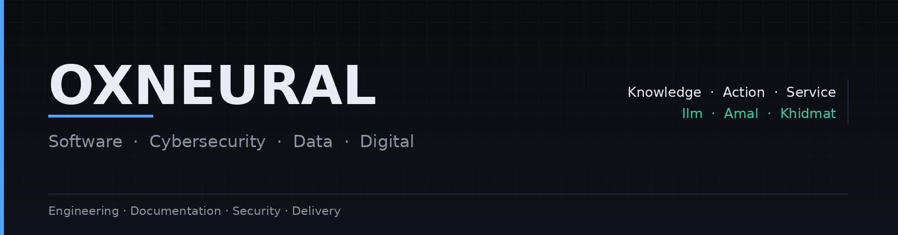

 

**Knowledge · Action · Service**
*Ilm · Amal · Khidmat*

 

---

## What We Build

OxNeural is a technology team building software, security and data systems — and documenting them to a standard that lets someone else operate, review or audit what we build.

| Area | What it covers |
|---|---|
| **Software & Application Development** | Backend systems, REST APIs, web applications, automation and integration work on a Python-centred stack |
| **Cybersecurity & SOC** | Security monitoring, SIEM and EDR operations, detection engineering, alert triage, investigation and incident response |
| **Data & Automation** | ETL pipelines, data cleaning and processing, analysis, and machine learning where it genuinely fits the problem |
| **Digital Services** | Content creation, video editing and digital marketing support — *an emerging capability, not an established department* |

---

## Core Technology Stack

Technologies listed here are ones the team works with. Anything not listed is not claimed.

**Languages & Frameworks**

**Data & Machine Learning**

**Databases**

**Cloud**

**Security & SOC**

**Engineering & Collaboration**

---

## Featured Projects

### [oxneural-soc-lab](https://github.com/Oxneural/oxneural-soc-lab)

A cloud SOC laboratory: log collection from AWS into a SIEM, detection engineering, automated enrichment, and incident response with human approval gates.

**Current state — design and documentation. No AWS resources are deployed.** The repository contains the architecture, the cost model, the deployment and teardown plans, the detection and incident-response documentation, and the acceptance criteria that define what "working" will mean. Build phases are documented but have not been executed.

Architecture: AWS · Wazuh (single-node) · Shuffle SOAR · IAM · CloudTrail · VPC Flow Logs · S3 · SSM Session Manager · threat-intelligence enrichment

Three design choices worth noting:

- **Zero inbound rules on every security group.** Access is exclusively through AWS Systems Manager Session Manager; dashboards are reached by port forwarding to localhost. No SSH, no exposed admin interface.
- **Every disruptive response action requires human approval.** Automation gathers context and prepares the action — a person decides. The SOAR platform holds no standing AWS permissions.
- **Every claim carries an evidence label.** `[VERIFIED FACT]` statements cite official AWS, Wazuh or Shuffle documentation; `[DESIGN DECISION]`, `[ASSUMPTION]` and `[OPEN QUESTION]` mark everything else. Test results stay empty until tests are actually run.

### [oxneural-handbook](https://github.com/Oxneural/oxneural-handbook)

The team's engineering standards, in the open: repository and README standards, git and commit conventions, pull-request expectations, a security baseline, detection-engineering method, client-confidentiality rules, and templates for project READMEs, statements of work, requirements specifications, case studies and security reviews.

It is public deliberately. Collaborators and clients can see how we work before engaging us, and our own standards get the same scrutiny as our code.

---

## Cybersecurity & SOC

**Capabilities:** SOC operations · security monitoring · SIEM and EDR operations and integration · alert triage · threat investigation · log analysis · incident response · IAM and cloud security · security hardening · vulnerability management · security assessments · security automation

**On 24/7 coverage:** scalable SOC capability subject to staffing, scope and SLA requirements. We do not operate a fully staffed round-the-clock SOC and do not claim to.

**On security testing:** selective, scope-based testing subject to written authorisation, defined scope, capability, timeline and resources. It is not our primary security positioning, and no testing of any kind happens without written authorisation.

---

## Software Engineering

Backend development in Python with Django and FastAPI · REST API design and integration · automation and scripting · JSON and CSV processing · web development with HTML, CSS and Bootstrap · hosting and domain management · relational database design across PostgreSQL, MySQL, Oracle, SQL Server and Snowflake · ETL and data processing · analysis and machine learning with pandas, NumPy, scikit-learn and River · deployment on AWS and Azure.

---

## Engineering Principles

| | |
|---|---|
| **Secure by design** | Least privilege, no standing credentials, no exposed admin interfaces |
| **Document everything** | If someone else cannot operate it from the documentation, it is not finished |
| **Test before delivery** | A control that has never been tested is an assumption, not a control |
| **Evidence over assertion** | No metric without a stated measurement method |
| **Honest labelling** | Personal, academic and previous work is never presented as company or client work |
| **Reviewable change** | Protected branches, pull requests, code review |
| **Reversibility** | Teardown and rollback written before build, not after |
| **Correct the record** | When we get something wrong, the correction stays in the repository |

---

## Team

**Leadership**

| Name | Role |
|---|---|
| [Muzaffar Moosa Shaikh](https://www.linkedin.com/in/cyber-shaikh/) | Founder · CEO · CTO |

**Software & Application Development**

| Name | Role |
|---|---|
| [Mashkoor Patel](https://www.linkedin.com/in/mashkoorpatel/) | Technical Lead — Development |
| [Huzefa Siddique Bagwan](https://www.linkedin.com/in/huzefabagwan/) | Python / ML Engineer — Development Support |
| [Muddassir Mushtaque](https://github.com/Muddassirsayyed) | Python / ML Engineer — Development Support |

**Cybersecurity & SOC**

| Name | Role |
|---|---|
| [Muzaffar Moosa Shaikh](https://www.linkedin.com/in/cyber-shaikh/) | Cybersecurity & SOC |
| [Ravishek Kumar](https://www.linkedin.com/in/ravishek23/) | Cybersecurity & SOC |

Team members maintain their own personal and academic repositories on their individual accounts. Those remain personal work and are not presented here as OxNeural projects or client deliveries.

---

## GitHub Engineering Standards

Public OxNeural repositories aim to include:

`README` · `Architecture` · `Setup instructions` · `Configuration` · `Security notes` · `Testing` · `Documentation` · `Roadmap` · `LICENSE` where applicable · `Contribution guidance` where applicable

Every repository declares a **Classification** — `OxNeural Project`, `OxNeural Internal Project`, `Client Project`, `Personal Project`, `Previous Work`, `Academic Project` or `Prototype` — and a **Status**. No repository is created without a purpose, and client work is private by default.

Full standard: [oxneural-handbook](https://github.com/Oxneural/oxneural-handbook)

---

## Portfolio Status

**The portfolio is being built.** Rather than publish filler, we are building a small number of properly engineered, fully documented projects, and they appear here as they are completed. No clients, results, metrics or deployments are claimed that have not happened.

---

**OxNeural** — Knowledge · Action · Service

